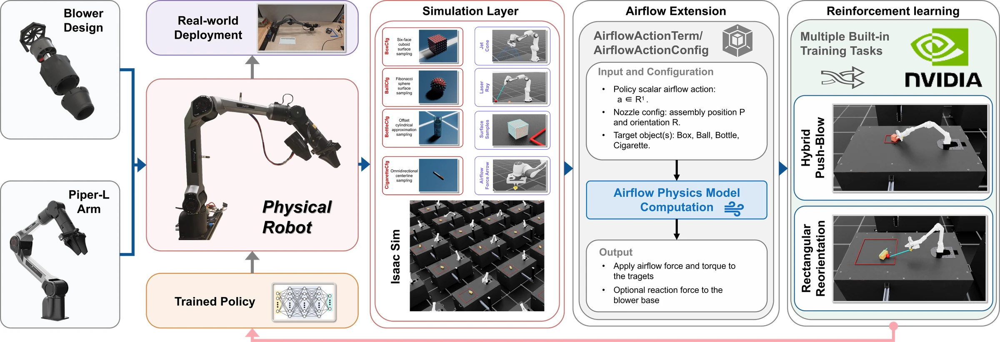
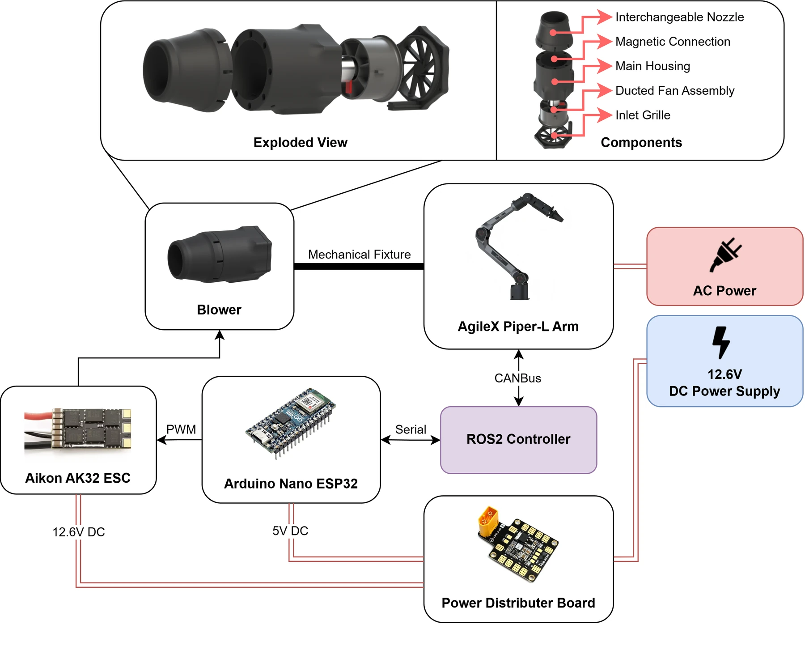
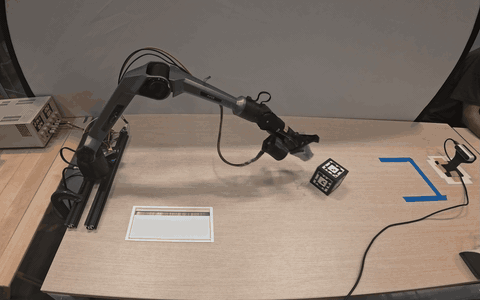
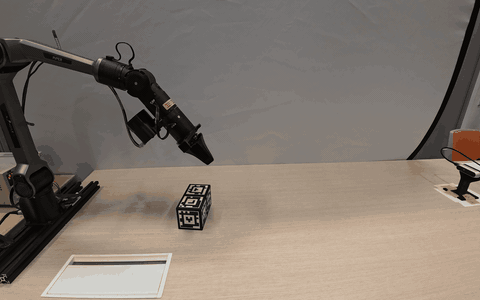
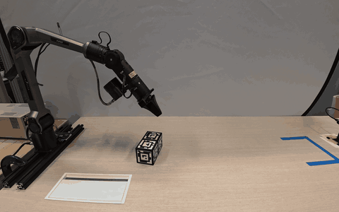
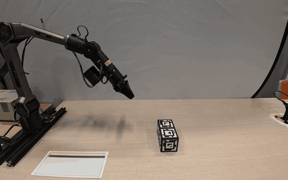
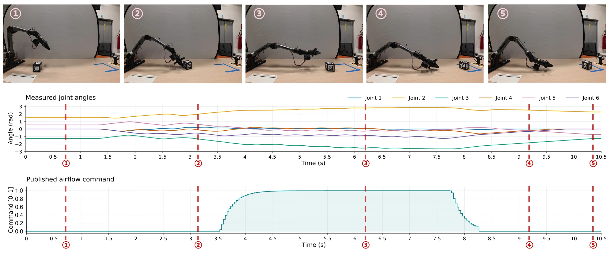
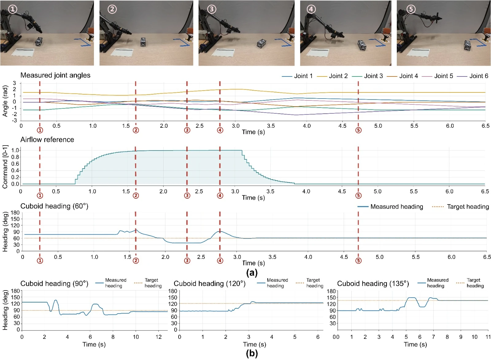

<div align="center">

# BeyondContact

### A Reinforcement Learning Framework for Airflow-Based Non-Contact Manipulation

Anonymous research release · Reinforcement learning · Grippers and other end-effectors, Non-contact manipulation

[Overview](#overview) · [Demonstrations](#demonstrations) · [Results](#experimental-results) · [Installation](#installation) · [Training](#train) · [Project website](#project-website)


</div>

## Overview

 Contact-based robotic manipulation is constrained by end-effector reachability and the mechanical properties of objects. Airflow can exert forces without physical contact, enabling manipulation of objects beyond the workspace or when direct contact is undesirable. Here we propose BeyondContact, a reinforcement learning framework for airflow-based non-contact manipulation.



The framework includes:

- **An airflow extension:** Develop a configurable and computationally efficient airflow-interaction module used in Isaac Lab, supporting massively parallel robot-learning environments.
- **Gripper-compatible hardware:** Design a lightweight, high-speed blower that coexists with the gripper, delivering a maximum air velocity of 78m/s and a static thrust of up to 5.9N (600gf).
- **Airflow modeling:** Experimentally identify centerline-decay and radial-spreading models for custom blowers and nozzles.
- **RL training frameworks:** Propose RL training frameworks that enable two different tasks.

The paper evaluates **zero-shot sim-to-real deployment**, with no real-world policy fine-tuning.

| Isaac Lab extension | Hardware design | Training tasks | Real-world HPB success | Real-world RR heading error |
| :---: | :---: | :---: | :---: | :---: |
| **1** · reusable airflow extension | **1** · gripper-compatible blower design | **2** · HPB and RR | **80%** · 16 / 20 trials | **2.6°** MAE · 4 headings |

## Demonstrations

### Hybrid push–blow:

The policy first pushes the cube into a position suitable for blowing, then adjusts the nozzle direction and airflow to guide it into the target region. Once the cube arrives, the airflow command decreases to zero. For targets within gripper reach, the policy primarily uses contact-based manipulation.

See the looping HPB demonstration in [Results](#experimental-results). The full experiment compilation is available on the [project website](#project-website).

### Rectangular reorientation:

The robot continuously adjusts the blowing direction to rotate a cuboid toward a target heading.

See the looping demonstrations for 60°, 90°, and 135° in [Results](#experimental-results). Full trial recordings are available on the [project website](#project-website).

## How it works

### Hardware

A **40 mm EDF** is housed in an enclosure beneath the gripper. A magnetic connection supports interchangeable nozzles. An ESP32 microcontroller regulates the blower through an ESC. <strong style="color: #8b0000;">The hardware design files will be released on the project website after the paper is published.</strong>

The blower can achieve a maximum air velocity of **78 m/s** and a static thrust of **5.9 N**. We limit the blower output during identification and training to accommodate the anemometer's measurement range and the task configuration.

<p align="center">
  <a href="docs/assets/hardware-system.webp">
    
  </a>
</p>

### Airflow modeling

We experimentally identify the airflow profile of the blower and nozzle, then use surface integration to convert airflow into object forces and torques.

### Reinforcement learning

Both tasks use PPO with an asymmetric actor–critic. The details of the training configurations are:

- **Actions:** robot joint-position commands and airflow action.
- **Architecture reported in the paper:** actor and critic MLPs with `[512, 256, 128]` hidden dimensions and ELU activations.
- **Robustness:** domain randomization over object mass, friction, robot gains, and airflow parameters.
- **Reported training setup:** 4,096 environments, 5,000 iterations, NVIDIA RTX 5090 and Intel U7 265K.

Check the [released PPO configuration](blower_arm_rl/source/blower_arm_rl/blower_arm_rl/tasks/manager_based/piper_blower_rl/agents/rsl_rl_ppo_cfg.py) and task configurations.

## Experimental results

We validated both tasks on physical Piper-L robotics arm.

### Real-world demonstrations

<table>
  <tr>
    <td width="50%" align="center">
      <strong>Hybrid push–blow</strong><br>HPB<br>
      
    </td>
    <td width="50%" align="center">
      <strong>Reorientation · 90°</strong><br>Airflow only<br>
      
    </td>
  </tr>
  <tr>
    <td width="50%" align="center">
      <strong>Reorientation · 60°</strong><br>Airflow only<br>
      
    </td>
    <td width="50%" align="center">
      <strong>Reorientation · 135°</strong><br>Airflow only<br>
      
    </td>
  </tr>
</table>

For HPB, the target is a **20 × 20 cm square centered 1.3 m in front of the robot base**. For RR, we setted four trails commanded at different final headings:

**HPB:** measured joint angles and airflow command through pushing, blowing, and settling.



**RR:** the 90° deployment sequence, joint and airflow traces, and heading trajectories for the other evaluated targets.




## Included components

| Path | Contents |
| --- | --- |
| [`external_blower/blower`](external_blower/blower) | Reusable airflow model, surface integration, object assets, and visualization |
| [`blower_arm_rl`](blower_arm_rl) | Piper-L task configurations, PPO training, and checkpoint evaluation |
| [`docs`](docs) | Static project website and optimized presentation media |

Registered training tasks:

| Paper task | Gym ID |
| --- | --- |
| Hybrid push–blow (HPB) | `Isaac-Blower-Piper-GripperAssistBoxPush-v0` |
| Rectangular reorientation (RR) | `Isaac-Blower-Piper-GripperAssistCuboidOrientation-v0` |

## Installation

Use an environment with **Isaac Sim 5.1.0**, an Isaac Lab installation, **Python 3.11**, PyTorch, and RSL-RL. Follow the [Isaac Lab installation guide](https://isaac-sim.github.io/IsaacLab/main/source/setup/installation/index.html).

Run from this repository root using these Python commands:

```bash
python -m pip install -e external_blower/blower/source/blower
python -m pip install -e blower_arm_rl/source/blower_arm_rl
python blower_arm_rl/scripts/list_envs.py
```

## Train

```bash
# Hybrid push–blow (HPB)
python blower_arm_rl/scripts/rsl_rl/train.py --task Isaac-Blower-Piper-GripperAssistBoxPush-v0 --headless

# Rectangular reorientation (RR)
python blower_arm_rl/scripts/rsl_rl/train.py --task Isaac-Blower-Piper-GripperAssistCuboidOrientation-v0 --headless
```

## Evaluate a trained checkpoint

Replace `/path/to/model.pt` with your trained checkpoint:

```bash
# Hybrid push–blow (HPB)
python blower_arm_rl/scripts/rsl_rl/play.py --task Isaac-Blower-Piper-GripperAssistBoxPush-Play-v0 --num_envs 1 --checkpoint /path/to/model.pt

# Rectangular reorientation (RR)
python blower_arm_rl/scripts/rsl_rl/play.py --task Isaac-Blower-Piper-GripperAssistCuboidOrientation-Play-v0 --num_envs 1 --checkpoint /path/to/model.pt
```

## Project website

The research page uses local assets and requires no frontend build step.

```bash
python -m http.server 8000 --directory docs
```

Visit **http://localhost:8000**. The site is self-contained in `docs/`, including its optimized figures, looping GIFs, and videos.
